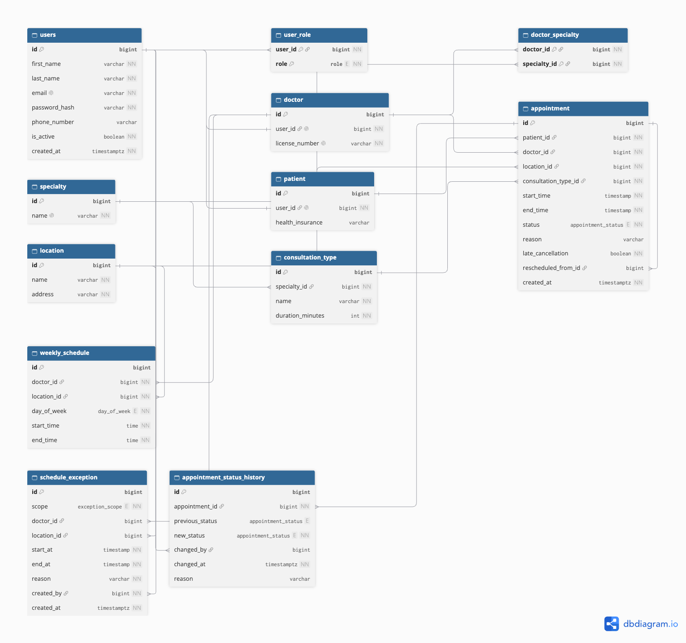

# Medical Appointments

API REST para la gestión de turnos de un centro médico con varias sedes.

## Funcionalidades
- [x] Esquema de base de datos con validaciones de solapamiento
- [ ] Especialidades y médicos
- [ ] Disponibilidad de turnos
- [ ] Reserva y cancelación
- [ ] Autenticación con JWT y roles

## Tecnologías
Java 25 · Spring Boot · PostgreSQL · Flyway · Docker

## Que se necesita
Java 25 y Docker

## Cómo correrlo
./mvnw spring-boot:run

## Diseño

### DER

[Ver versión interactiva en dbdiagram](https://dbdiagram.io/d/DER-6a8dbe296440800f52de980c)

## Endpoints
(link a Swagger)